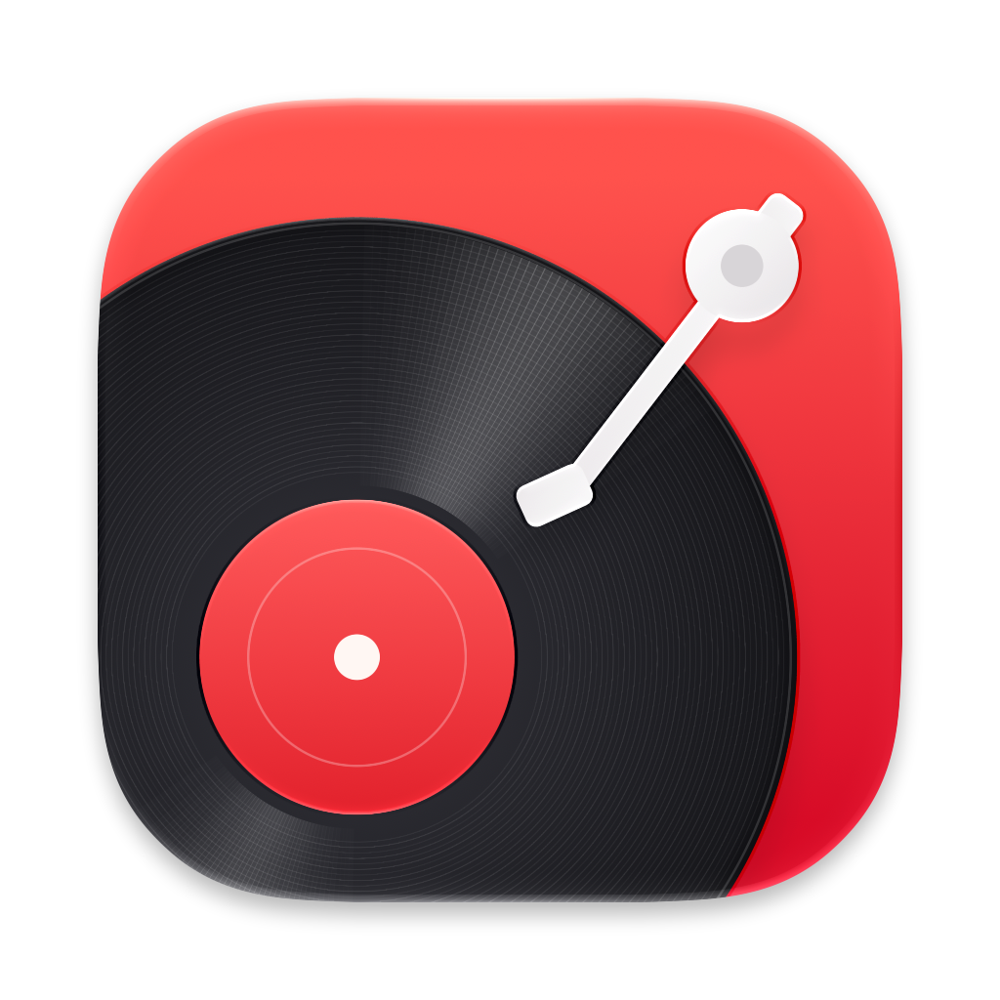
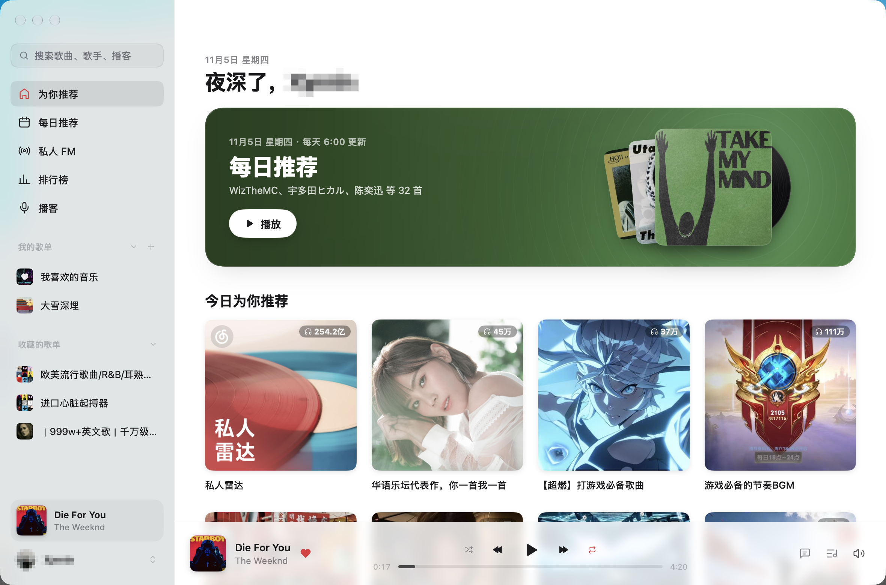
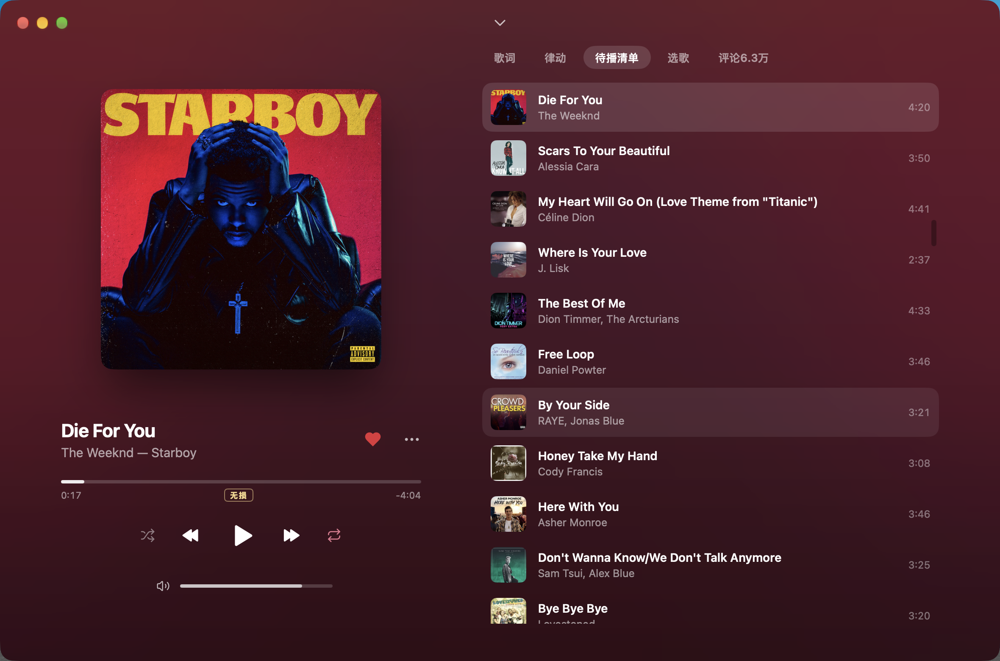
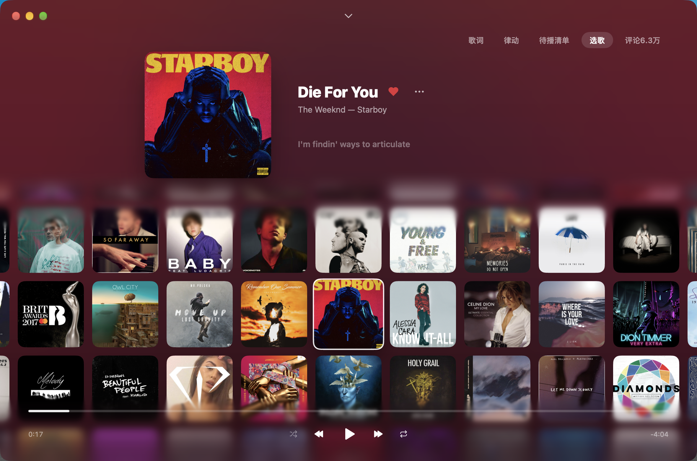

<p align="center">
<a href="resources/icon.png"></a><br>
<sub></sub>
</p>
<h1 align="center">春日影</h1>

<p align="center">
用 Go 和 <a href="https://github.com/egoist/mygo">MyGo</a> 写的跨平台音乐播放器，原生界面，无 WebView。
</p>

<p align="center">
<a href="https://awesomemygo.dev/apps/haruhikage-app"></a>
</p>

## 赞助说明
请联系: xynrin@icloud.com

## 界面



<p align="center"><sub>主界面 · 推荐、每日推荐与收藏的歌单</sub></p>

| 待播清单 | 选歌 |
| :---: | :---: |
|  |  |
| <sub>队列里的歌，随时切换</sub> | <sub>在封面墙里挑下一首</sub> |


## 功能

- 推荐、歌单、排行榜与我的收藏
- 搜索单曲、歌手、专辑、用户与播客，输入时显示搜索建议，保留搜索历史
- 歌手页的热门与最新歌曲、专辑与动态，关注歌手；专辑页与用户页
- 播客：浏览与收听节目，订阅播客；在本机把节目转写成字幕（Qwen3-ASR），像歌词一样随播放滚动
- 连续播放（推荐 / 熟悉 / 探索）与心动模式
- 边下边播，支持标准 / 较高 / 极高 / 无损（FLAC）/ Hi-Res 音质
- 听过的歌曲缓存在本机，再次播放无需等待
- 音量均衡，暂停与继续时淡出淡入，拖动进度无杂音
- 退出后再打开，从上次的播放队列与进度继续
- 逐字歌词与翻译，正在播放页的「律动」视图与歌曲评论
- 刘海播放器：在屏幕顶部刘海处显示迷你播放器，悬停展开（在设置中开启）
- 喜欢歌曲、播放队列、随机与循环播放
- 浅色 / 深色 / 跟随系统


## 构建

需要 Go 1.27+。

```bash
go tool mygo dev     # 开发模式运行
go tool mygo build   # 打包到 build/
go test ./...        # 运行测试
```

## 致谢

- [MyGo](https://github.com/egoist/mygo)：原生 UI 与应用框架
- [folia-major](https://github.com/chthollyphile/folia-major)：歌词动画效果的参考
- [sherpa-onnx](https://github.com/k2-fsa/sherpa-onnx)、[Qwen3-ASR](https://github.com/QwenLM/Qwen3-ASR) 与 [Silero VAD](https://github.com/snakers4/silero-vad)：本机语音识别

音乐与节目内容的版权归各权利人所有。

## 许可证

[AGPL-3.0](LICENSE)
